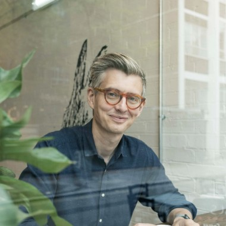

## Fermentation project {.center}

:::: {.columns}
::: {.column width="55%"}
Repositorio del proyecto:

[github.com/AltamarMx/fermentation-project](https://github.com/AltamarMx/fermentation-project){style="font-size: 0.6em;"}
:::
::: {.column width="45%"}
{width="320" fig-alt="Código QR al repositorio en GitHub"}
:::
::::

## Cómo romper la costra {#costra}

```{=html}
<div class="video-wrap">
  <iframe data-src="https://www.youtube.com/embed/6EOZSHHfHYs?autoplay=1&mute=1&loop=1&playlist=6EOZSHHfHYs&rel=0&enablejsapi=1"
          data-autoplay
          title="Cupping Coffee - Breaking the Crust"
          allow="autoplay; encrypted-media; picture-in-picture; fullscreen"
          allowfullscreen></iframe>
</div>
```

[Video: *Cupping Coffee – Breaking the Crust*, Coffee Lovers TV]{.video-credito}

## Los 4 cafés {#cafes}

::: {.cafe-grid}
::: {.cafe}
[1 · Desmucilaginado mecánico]{.cafe-titulo}
**Sin fermentación (control).** El perfil viene de las prácticas de cultivo y de la genética de la variedad.
:::
::: {.cafe}
[2 · Fermentación silvestre]{.cafe-titulo}
**48 h, microbios locales.** El método tradicional: la población microbiana local elimina el mucílago.
:::
::: {.cafe}
[3 · Inoculado con *Lactobacillus*]{.cafe-titulo}
**48 h.** Produce más ácidos orgánicos: más brillo y complejidad.
:::
::: {.cafe}
[4 · Inoculado con *Saccharomyces*]{.cafe-titulo}
**48 h, levadura.** Produce más precursores de sabor: más cuerpo y complejidad.
:::
:::

::: {.personas}
::: {.persona}
{.foto fig-alt="James Hoffmann"}
[James Hoffmann]{.nombre}
[Cata en vivo en su canal de YouTube]{.rol}
:::
::: {.persona}
[LS]{.foto .iniciales}
[Lucia Solis]{.nombre}
[Procesó los cuatro lotes con el equipo de la finca]{.rol}
:::
:::

::: {.origen}
Finca San Miguel Urias (Hector y Lilian Leal, Rueda Farms) · Antigua, Guatemala · ~85% Caturra, ~15% H1, algo de Bourbon
:::

## Lo único que cambia es la fermentación {#veracruz}

[Misma finca · Obatã + Anacafé 14 · mismo lavado · Totutla, Veracruz]{.tl-sub}

```{=html}
<div class="tl">
  <div class="tl-row tl-axis">
    <div></div>
    <div class="tl-track">
      <span style="left:0%">0 h</span><span style="left:40%">96</span><span style="left:60%">144</span><span style="left:100%">240 h</span>
    </div>
    <div></div>
  </div>
  <div class="tl-row">
    <div class="tl-id">BL01</div>
    <div class="tl-track"><div class="tl-bar" style="width:40%;background:#1f3a2e"></div>
      <p><b>BactoNativa</b> · bacterias lácticas nativas inoculadas a las 48 h.</p></div>
    <div class="tl-h">96 h</div>
  </div>
  <div class="tl-row">
    <div class="tl-id">BL02</div>
    <div class="tl-track"><div class="tl-bar" style="width:60%;background:#b8ad85"></div>
      <p><b>BactoNativa</b> · bacterias acéticas nativas inoculadas a pH 4.5.</p></div>
    <div class="tl-h">144 h</div>
  </div>
  <div class="tl-row">
    <div class="tl-id">BL03</div>
    <div class="tl-track"><div class="tl-bar" style="width:100%;background:#6b2737"></div>
      <p><b>EnziBio</b> · infusión enzimática (pectinasas, celulasas, xilanasas, glucosidasas) y acéticas nativas 24 h después.</p></div>
    <div class="tl-h">240 h</div>
  </div>
  <div class="tl-row tl-sep">
    <div class="tl-id">B80</div>
    <div class="tl-track"><div class="tl-bar" style="width:100%;background:#b4c7d3"></div>
      <p><b>Infusión con frutos rojos.</b> Fuera de la escala de tiempo: aquí la variable no son las horas.</p></div>
    <div class="tl-h tl-inf">INFUSIÓN</div>
  </div>
</div>
```

::: {.origen}
Todas las cepas se identificaron por secuenciación metagenómica del propio cafetal. Fermentaciones en biorreactor de acero inoxidable.
:::

## Mesa de cata {#mesa}

::: {.mesa}
[Antigua, Guatemala · Caturra, H1, Bourbon]{.mesa-col}
[Totutla, Veracruz · Obatã + Anacafé 14]{.mesa-col}

::: {.taza style="--c:#7a7a7a"}
[1 · Desmucilaginado mecánico]{.taza-t}
[Sin fermentación (control)]{.taza-d}
:::
::: {.taza style="--c:#1f3a2e"}
[BL01 · 96 h]{.taza-t}
[BactoNativa · lácticas nativas a las 48 h]{.taza-d}
:::

::: {.taza style="--c:#6b8e23"}
[2 · Fermentación silvestre]{.taza-t}
[48 h · microbios locales]{.taza-d}
:::
::: {.taza style="--c:#b8ad85"}
[BL02 · 144 h]{.taza-t}
[BactoNativa · acéticas nativas a pH 4.5]{.taza-d}
:::

::: {.taza style="--c:#c9a227"}
[3 · Inoculado con *Lactobacillus*]{.taza-t}
[48 h · más ácidos orgánicos]{.taza-d}
:::
::: {.taza style="--c:#6b2737"}
[BL03 · 240 h]{.taza-t}
[EnziBio · enzimas + acéticas nativas]{.taza-d}
:::

::: {.taza style="--c:#8b3a62"}
[4 · Inoculado con *Saccharomyces*]{.taza-t}
[48 h · más precursores de sabor]{.taza-d}
:::
::: {.taza style="--c:#b4c7d3"}
[B80 · Infusión]{.taza-t}
[Infusión con frutos rojos]{.taza-d}
:::
:::

## Objetivo

- Por definir

## Metodología

- Por definir

## Resultados

- Por definir

## LIVE! The World's Largest Coffee Tasting {#en-vivo .video-slide}

```{=html}
<div class="video-wrap">
  <iframe data-src="https://www.youtube.com/embed/98MD900CAzg?rel=0&enablejsapi=1&start=2314"
          title="LIVE! The World's Largest Coffee Tasting"
          allow="encrypted-media; picture-in-picture; fullscreen"
          allowfullscreen></iframe>
</div>
```

[Video: James Hoffmann · Empieza en 38:34]{.video-credito}

## Taste Coffee With Me For The Last Time {#ultima-cata .video-slide}

```{=html}
<div class="video-wrap">
  <iframe data-src="https://www.youtube.com/embed/Iy8m7AbZVm0?rel=0&enablejsapi=1"
          title="Taste Coffee With Me For The Last Time"
          allow="encrypted-media; picture-in-picture; fullscreen"
          allowfullscreen></iframe>
</div>
```

[Video: James Hoffmann]{.video-credito}

## I Went To Guatemala To Explain Why All Coffee Is Fermented {#guatemala .video-slide}

```{=html}
<div class="video-wrap">
  <iframe data-src="https://www.youtube.com/embed/Iq34gq2ihMk?rel=0&enablejsapi=1"
          title="I Went To Guatemala To Explain Why All Coffee Is Fermented"
          allow="encrypted-media; picture-in-picture; fullscreen"
          allowfullscreen></iframe>
</div>
```

[Video: James Hoffmann]{.video-credito}
